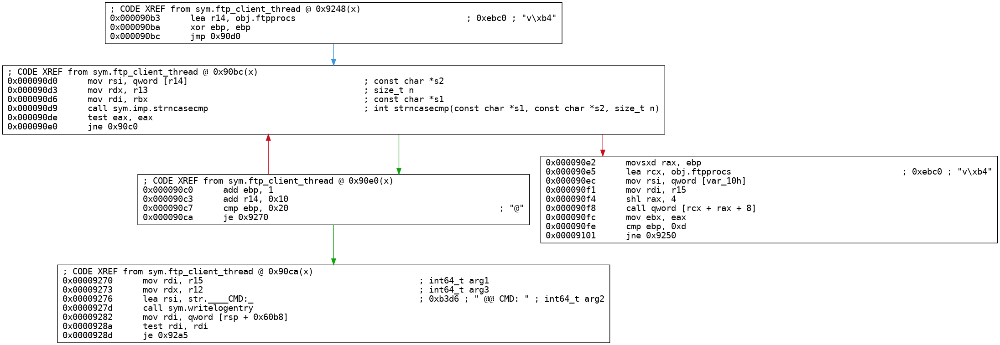

# BINSEC

## Creating the core dump

After setting up [BINSEC](https://github.com/binsec/binsec), you need to follow these instructions to create a valid core dump to be analyzed by BINSEC:

1. Set dynamic linker to resolve all symbols at program startup instead of deferring function call resolution to the point when they are first referenced:

```console
$ export LD_BIND_NOW=1
```

2. Load your executable in the GNU Debugger (remember to preserve the already defined environment variable if your gaining privileges):

```console
$ sudo --preserve-env=LD_BIND_NOW gdb --args /path/to/executable arg1 arg2
```

3. Create a core dump of the debugged process:

```console
(gdb) b main
Breakpoint 1 at 0x35e0
(gdb) r
Starting program: /path/to/executable arg1 arg2
[Thread debugging using libthread_db enabled]
Using host libthread_db library "/lib/x86_64-linux-gnu/libthread_db.so.1".

Breakpoint 1, 0x00005555555575e0 in main ()
(gdb) generate-core-file core.snapshot
warning: target file /proc/2785/cmdline contained unexpected null characters
Saved corefile core.snapshot
```

## Analyzing the executable with BINSEC

Now, you have to set goals and symbolic variables in a separated `.ini` file. For example, to obtain strings that satisfy the following code block:



We create the following `.ini` file:

```ini
starting from core

# entrypoint from core dump (program counter)
replace 0x5555555575e0 by
    rbx := 0xfffff000000000             # input buffer
    r13 := nondet                       # input len
    assume 0 < r13 < 8                  # 0 < strlen(input) < 8
    @[rbx, 128] := 0                    # clear buffer
    for i<64> in 0 to r13 - 1 do
        @[rbx + i] := nondet as token   # fill symbolic input
        assume "A" <= token <= "Z"      # such that it is uppercase
    end
    jump at 0x55555555d0b3              # real entrypoint

reach * 0x55555555d0e2 then print ascii stream token
cut at 0x55555555d0e2
cut at 0x55555555d270
```

First, we specify to BINSEC to analyze the generated core dump. Now, we replace the entrypoint of the core dump with our symbolic definitions. To obtain the entrypoint (program counter) we can use the gdb itself:

```console
$ gdb -c core.snapshot
Core was generated by `/path/to/executable arg1 arg2'.
Program terminated with signal SIGTRAP, Trace/breakpoint trap.
#0  0x00005555555575e0 in ?? ()
(gdb) info registers rip
rip            0x5555555575e0      0x5555555575e0
```

Or with radare2:

```console
$ r2 core.snapshot 
Setting up coredump arch-bits to: x86-64
Setting up coredump: Registers have been set
Setting up coredump: 53 maps have been found and created
 -- radare2-built farm beats the facebook one.
[0x5555555575e0]> dr?rip
0x5555555575e0
```

At the end of our function definition, we jump to our code block to start the analysis, that is, 0x90b3 in the previous image. To translate between mapped addresses in the coredump and the executable, we can tell to radare2 to map the executable in the base address that was used in the coredump. To obtain the base address, we can use either the rabin2 utility (installed alongside radare2):

```console
$ rabin2 -I core.snapshot
arch     x86
baddr    0x555555554000
[...]
```

Or radare2:

```console
$ r2 core.snapshot
Setting up coredump arch-bits to: x86-64
Setting up coredump: Registers have been set
Setting up coredump: 53 maps have been found and created
 -- We feed trolls
[0x5555555575e0]> i
fd       3
file     core.snapshot
size     0x1966d0
humansz  1.6M
mode     r-x
format   elf64
iorw     false
block    0x100
type     CORE (Core file)
arch     x86
baddr    0x555555554000
[...]
```

Now, we can analyze our executable with the same base address as the one in the coredump, and translate our desired addresses:

```console
$ r2 -B 0x555555554000 /path/to/executable
Warning: run r2 with -e bin.cache=true to fix relocations in disassembly
 -- Your project name should contain an uppercase letter, 8 vowels, some numbers, and the first 5 characters of your private bitcoin key.
[0x555555557bc0]> pd 10 @ 0x55555555d0b3
            0x55555555d0b3      4c8d35065b00.  lea r14, obj.ftpprocs   ; 0x555555562bc0 ; "v\xb4"
            0x55555555d0ba      31ed           xor ebp, ebp
        ┌─< 0x55555555d0bc      eb12           jmp 0x55555555d0d0
        │   0x55555555d0be      6690           nop
        │   0x55555555d0c0      83c501         add ebp, 1
        │   0x55555555d0c3      4983c610       add r14, 0x10           ; 16
        │   0x55555555d0c7      83fd20         cmp ebp, 0x20           ; 32
       ┌──< 0x55555555d0ca      0f84a0010000   je 0x55555555d270
       │└─> 0x55555555d0d0      498b36         mov rsi, qword [r14]
       │    0x55555555d0d3      4c89ea         mov rdx, r13
```

## Use of BINSEC

First, we need to activate OCaml toolchain:

```console
$ eval $(opam env)
```

And then, we can use BINSEC with the following options:

```console
$ binsec -sse -sse-script crackme.ini core.snapshot -sse-alternative-engine
[...]
[sse:result] Ascii stream token : "PORT"
[sse:result] Ascii stream token : "PASV"
[sse:result] Ascii stream token : "PASS"
[sse:result] Ascii stream token : "TYPE"
[sse:result] Ascii stream token : "LIST"
[sse:result] Ascii stream token : "CDUP"
[sse:result] Ascii stream token : "RETR"
[sse:result] Ascii stream token : "REST"
[sse:result] Ascii stream token : "ABOR"
[sse:result] Ascii stream token : "DELE"

[sse:info] Empty path worklist: halting ...
[sse:info] SMT queries
             Preprocessing simplifications
               total          23301
               sat            448
               unsat          18382
               constant enum  4471
             
             Satisfiability queries
               total          6893
               sat            296
               unsat          6597
               unknown        0
               time           39.64
               average        0.01
             
           Exploration
             total paths                      289
             completed/cut paths              57
             pending paths                    232
             stale paths                      0
             failed assertions                0
             branching points                 30069
             max path depth                   1050
             visited instructions (unrolled)  130844
             visited instructions (static)    152
```
